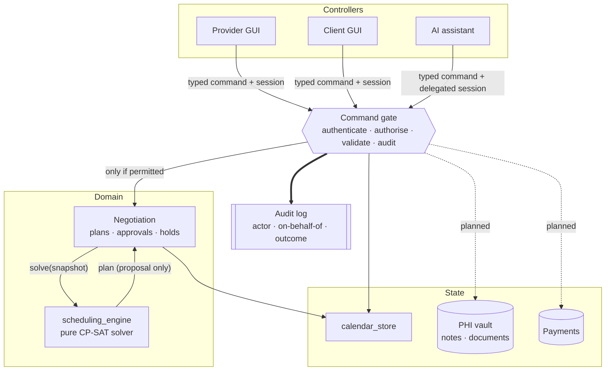
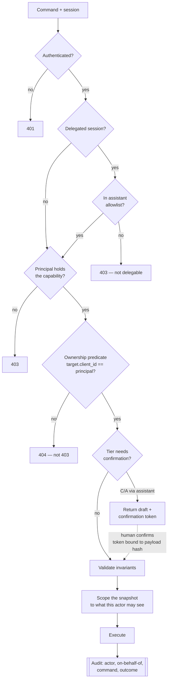
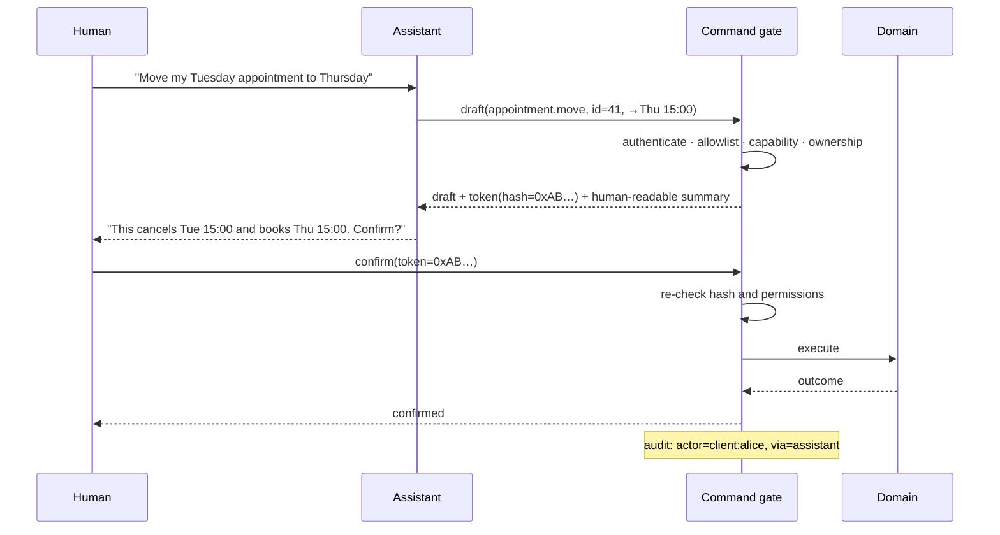

# Control surface — commands, controllers, and authorisation

How the scheduling core is driven from outside, who is allowed to drive it, and
where the security boundary sits. Written as the target design; the last section
records how far today's code is from it.

**The one rule everything else follows:** a command carries *what* should happen.
It never carries *who is asking* — that is ambient, established at the session
edge, and attached by the gate. Today the opposite is true, which is the single
largest gap (see [Where we are now](#where-we-are-now)).

---

## 1. The separation

Three controllers, one entrance. The GUI and the assistant are peers: neither has
a private path to the domain, and the assistant gets no capability that its human
does not already hold.



**Why the gate is a real component and not a decorator.** The three controllers
have different trust properties — a GUI session is a human at a keyboard, an
assistant session is a language model that can be talked into things by the
person it is serving *or by text it reads*. If authorisation lives in each
controller, it is implemented three times and the weakest one defines the system.
One gate means the assistant cannot exceed its delegator no matter what it is
persuaded to emit.

**What stays in the engine.** `scheduling_engine` remains pure: segments in,
plan out, no identity, no I/O, no permissions. It cannot leak what it never
receives. Authorisation happens before it is called, and *scoping* — which
client's data is in the snapshot at all — happens on the way in.

---

## 2. Controllers

| Controller | Identity | Holds | Notes |
|---|---|---|---|
| **Provider** | Authenticated staff account | Full authority over the practice | Later splits into roles (owner, receptionist, clinician) — the model already supports it |
| **Client** | Authenticated client account | Own records only | Cannot see another client exists |
| **Assistant** | Delegated session, bound to one human | A **subset** of that human's capability | Never a principal in its own right |
| *(System)* | Internal scheduler tick | Time-triggered runs only | No human, no reads out |

### The assistant is delegation, not a third role

```
capabilities(assistant) = capabilities(delegator) ∩ ASSISTANT_ALLOWLIST
```

Strictly an intersection, computed at the gate. Two consequences worth stating
plainly:

- A client's assistant can never reach another client's data, because the
  delegator cannot either.
- A provider's assistant is *not* an admin. The allowlist removes the
  irreversible and the financial regardless of who delegates.

**Prompt injection is an authorisation problem, not a prompt problem.** The
assistant reads client-supplied text — messages, notes, uploaded documents. Any
of it may contain instructions. The defence is that the gate does not consult
the model's intent: a command to cancel someone else's appointment fails the
ownership predicate whether the model was tricked or not. Nothing in the system
prompt is load-bearing for security.

---

## 3. Sensitivity tiers

Every command carries a tier. The tier — not the resource — decides what extra
ceremony applies.

| Tier | Meaning | Assistant may act alone? |
|---|---|---|
| **R** Read | Returns data, changes nothing | Yes, within scope |
| **W** Routine write | Reversible, affects only the actor | Yes |
| **C** Consequential | Affects another person's calendar, or is hard to undo | **Draft only** — human confirms |
| **A** Authority | Provider's judgement recorded as fact | **Draft only** |
| **X** Destructive | Irreversible or bulk | **Never** |
| **$** Financial | Moves money or creates a debt | **Never** |
| **P** PHI-bearing | Clinical content | Read within scope; writes are C |

---

## 4. The command map

Legend — **●** allowed · **◐** own records only · **✎** may draft, human confirms ·
**○** denied

Status — **live** exists today · **gap** exists but unprotected · **new** to be built

On three reads — `approval.list`, `view.snapshot`, `view.holds` — **◐** is
enforced differently from everywhere else. They point at no single record, so
there is nothing for an ownership check to compare against; the scoping is the
**projection's** job, and the response must be computed for the actor rather
than filtered afterwards. `scheduling_contracts.PROJECTION_SCOPED` names them
and a test pins the list, so a new broadly-granted read cannot be added without
deciding this.

### A. Directory & catalogue

| Command | Effect | Tier | Prov | Client | Asst | Status |
|---|---|---|---|---|---|---|
| `client.add` | Register a client | W | ● | ○ | ✎ | live |
| `client.summary` | Counts, history at a glance | R,P | ● | ◐ | ◐ | live |
| `client.set_limits` | At most N sessions a day / a week for this client | W | ● | ○ | ✎ | gap |
| `service.add` | Add a bookable service | W | ● | ○ | ✎ | live |
| `service.set_active` | Withdraw/restore a service | C | ● | ○ | ✎ | live |
| `service.list` | Catalogue | R | ● | ● | ● | live |

### B. Availability

| Command | Effect | Tier | Prov | Client | Asst | Status |
|---|---|---|---|---|---|---|
| `availability.set_weekly` | Replace the weekly pattern | W | ● | ◐ | ✎ | gap |
| `availability.set_exception` | Override one date | W | ● | ◐ | ✎ | gap |
| `availability.clear_exception` | Undo an override | W | ● | ◐ | ✎ | gap |
| `availability.read` | Resolved segments | R | ● | ◐ | ◐ | gap |

> Changing availability **never reschedules anybody** — stranded bookings become a
> query, not an event. That property is load-bearing and must survive the
> refactor.

### C. Requests

| Command | Effect | Tier | Prov | Client | Asst | Status |
|---|---|---|---|---|---|---|
| `request.submit` | Ask for a service at a wished time | W | ● | ◐ | ✎ | gap |
| `request.withdraw` | Take the ask back | W | ● | ◐ | ✎ | gap |
| `request.list` | The queue | R | ● | ◐ | ◐ | live |
| `series.start` | Same service every N weeks, each session raised as a request when it comes into the planning window | W | ● | ◐ | ✎ | gap |
| `series.stop` | No more sessions; ones still being placed are withdrawn | W | ● | ◐ | ✎ | gap |

> A series is a **standing request, not a block booking**. Each session still
> goes through the scheduler and the client's agreement, so a repeating client
> cannot hold an hour against everyone else just by having asked once.

### D. Appointments

| Command | Effect | Tier | Prov | Client | Asst | Status |
|---|---|---|---|---|---|---|
| `appointment.cancel` | End a booking | C | ● | ◐ | ✎ | gap |
| `appointment.move` | Client moves their own booking | C | ● | ◐ | ✎ | gap |
| `appointment.request_reschedule` | Ask to be moved, without naming where | W | ● | ◐ | ✎ | gap |
| `appointment.mark_attendance` | Record turned up / no-show | A | ● | ○ | ✎ | gap |
| `appointment.place_manually` | Provider books a waiting request by hand | A | ● | ○ | ✎ | live |
| `appointment.read` | Own bookings | R,P | ● | ◐ | ◐ | live |

> `cancel` must derive `Party.CLIENT` / `Party.PROVIDER` **from the authenticated
> actor**. It is currently a boolean in the request body, and the distinction is
> not cosmetic — it is training data for habitual-slot anchoring.

### E. Scheduling runs

| Command | Effect | Tier | Prov | Client | Asst | Status |
|---|---|---|---|---|---|---|
| `plan.propose` | Run the solver, produce a draft | C | ● | ○ | ✎ | live |
| `plan.tick` | Policy-driven automatic run | — | *system* | ○ | ○ | live |
| `plan.list` | Drafts and their metrics | R | ● | ○ | ● | live |
| `plan.discard` | Drop a draft | W | ● | ○ | ✎ | live |

> `propose` is provider-only for two independent reasons: it reasons over the
> whole practice (a client-triggered run would be an inference channel into other
> people's calendars), and it is the expensive operation — seconds of CP-SAT, and
> therefore a denial-of-service surface if exposed.

### F. Consent & negotiation

| Command | Effect | Tier | Prov | Client | Asst | Status |
|---|---|---|---|---|---|---|
| `plan.approve` | Send a draft on to affected clients | C | ● | ○ | ✎ | live |
| `approval.respond` | Accept / decline / refuse **your own** part | C | ○ | ◐ | ✎ | gap |
| `plan.settle` | Write agreed changes to the calendar | C | ● | ○ | ✎ | live |
| `plan.reject` | Abandon and re-plan | W | ● | ○ | ✎ | live |
| `approval.list` | Outstanding questions | R | ● | ◐ | ◐ | live |

> **`approval.respond` is the one command the provider must not hold.** Everywhere
> else the provider outranks the client; here, answering on someone's behalf would
> forge the consent the whole negotiation exists to obtain. The provider can
> cancel a plan, not answer for a person. An assistant may never auto-accept
> either — agreeing to be moved is the human's decision by construction.

### G. Provider operations

| Command | Effect | Tier | Prov | Client | Asst | Status |
|---|---|---|---|---|---|---|
| `provider.away` | Mark time off, handle what is in it | A,X | ● | ○ | ✎ | live |
| `orphans.list` | Bookings stranded by an availability change | R | ● | ○ | ● | live |
| `orphans.rehouse` | Raise a request per stranded client | C | ● | ○ | ✎ | live |
| `orphans.cancel` | End them outright | X | ● | ○ | ○ | live |

### H. Optimiser control

The provider steers the optimiser, and this is a first-class part of the control
surface rather than a settings page. Three kinds of knob are currently muddled
into one endpoint; they differ in who should own them and in what goes wrong when
they are set badly.

| Command | Effect | Tier | Prov | Client | Asst | Status |
|---|---|---|---|---|---|---|
| `optimiser.read` | Current values and their bounds | R | ● | ○ | ● | live |
| `optimiser.set_objective` | What a good schedule means | A | ● | ○ | ○ | live |
| `optimiser.set_policy` | When a run fires, what it considers | A | ● | ○ | ○ | live |
| `optimiser.set_budget` | What a run is allowed to cost | A | ● | ○ | ○ | partial |
| `optimiser.set_bounds` | The limits a provider may set within | X | *platform* | ○ | ○ | **new** |

**H1 — Objective shape.** Business judgement. Wrong values give a schedule the
provider dislikes; nothing breaks.

| Parameter | Default | Meaning |
|---|---|---|
| `alpha` | `0.5` | Packing versus earliness. `1.0` packs tight, `0.0` books earliest |
| `service_durations` | from catalogue | Defines gap usability; derived, not set directly |
| *(deferred)* disruption weights | — | SPEC §10 — settled against real history, not in the abstract |

**H2 — Run policy.** When the scheduler fires and over what. `policy.py` calls
this *usage policy, not algorithm* — the engine is indifferent to when it is
called.

| Parameter | Default | Meaning |
|---|---|---|
| `auto_run` | `true` | Master switch for automatic runs |
| `weekly_runs` | `Mon 08:00` | Standing scheduled runs |
| `urgency_hours` | `24` | A request wanted sooner than this earns its own run |
| `retry_after_minutes` | `60` | How long before unsatisfied work is retried |
| `scope_to_horizon` | `true` | Whether a run *selects* by horizon or merely plans within it |
| `rehouse_orphans_on_run` | `false` | Whether a run raises rehousing requests itself |

**H3 — Resource budget.** Governs tractability rather than preference. **This is
the denial-of-service surface**, and the only group where a provider can hurt
themselves with a plausible-looking number.

| Parameter | Default | Cost behaviour |
|---|---|---|
| `horizon_days` | `7` | **Dominant cost.** 7 days ~2s against 21 days ~11s at 25 clients / 20 requests |
| `max_displacements` | `0` | Prunes hard; small is what keeps displacement solves fast |
| `allow_chains` | `false` | 5–10× solve time, measured to buy nothing |
| `grid_minutes` | `30` | Finer roughly doubles candidates and quadruples solve time |
| `time_limit_seconds` | `10` | Applies **per phase**, so a saturated call can take twice it |

**The guardrail principle: the provider sets the value, the platform sets the
bound.** Compute is shared, and `horizon_days` is accepted today with no upper
limit — `3650` is a valid input. Bounds belong to `optimiser.set_bounds`, which
is a platform-operator command the provider does not hold. It is the only place
in this map where something is withheld from the provider for reasons of resource
control rather than authority.

**Standing defaults versus per-run overrides.** `plan.propose` may override the
saved values for one run, which is how the provider compares trade-offs side by
side. Both paths are provider-only and both must clamp to the same bounds — an
override is not an escape hatch. Two asymmetries to fix while formalising this:
`allow_chains` is settable per run but not as a default, and `grid_minutes` and
`time_limit_seconds` are not exposed at all.

### I. Read surface

| Command | Effect | Tier | Prov | Client | Asst | Status |
|---|---|---|---|---|---|---|
| `view.snapshot` | Everything a view needs | R,P | ● | ◐ | ◐ | **gap — see below** |
| `view.holds` | Time promised but not confirmed | R | ● | ◐ | ◐ | live |

> **This is the largest privacy hole.** `snapshot()` returns the whole world —
> every client, every booking — to any caller, and the front end filters for
> display. Filtering in the client is not filtering. It must become a
> **projection computed per actor**, so a client's payload never contains another
> client's name, and an assistant's context window can never be made to recite it.

### J. System

| Command | Effect | Tier | Prov | Client | Asst | Status |
|---|---|---|---|---|---|---|
| `system.reset` | Wipe and reseed | X | *admin* | ○ | ○ | live |
| `system.save` | Snapshot session to disk | W | *admin* | ○ | ○ | live |

### K. Payments — planned

| Command | Effect | Tier | Prov | Client | Asst |
|---|---|---|---|---|---|
| `invoice.issue` | Create a charge for an appointment | $ | ● | ○ | ○ |
| `invoice.read` | See own invoices | R,$ | ● | ◐ | ◐ |
| `payment.take` | Charge a stored method | $ | ● | ◐ | ○ |
| `payment.refund` | Return money | $,X | ● | ○ | ○ |
| `payment_method.add` | Store a method | $ | ○ | ◐ | ○ |

> No assistant writes in this group at any tier, including drafts. The failure
> mode of a mis-drafted charge that a distracted human waves through is
> materially worse than the convenience is worth. Card data never enters the
> domain — a processor token is the only thing stored.

### L. Documents — planned

| Command | Effect | Tier | Prov | Client | Asst |
|---|---|---|---|---|---|
| `document.request` | Ask a client for a document | W,P | ● | ○ | ✎ |
| `document.upload` | Provide one | W,P | ● | ◐ | ○ |
| `document.read` | Retrieve | R,P | ● | ◐ | ◐ |
| `document.revoke` | Withdraw access | C,P | ● | ◐ | ✎ |

> `document.upload` is closed to assistants deliberately: a model that can write
> into the clinical record is a model whose mistakes become medical history.

---

## 5. How a command is authorised

Ordered, and the order matters — cheap rejections first, and *scoping happens
before the domain sees anything*, so an over-broad query cannot be the leak.



**404, not 403, on ownership failure.** Telling a client that appointment 41
exists but is not theirs confirms another client's booking. Denial must not be an
oracle.

**The confirmation token binds to a hash of the exact payload.** Otherwise an
assistant can obtain approval for a harmless draft and submit a different one —
the confused-deputy problem, which is the realistic attack on an LLM controller.

---

## 6. Two-phase execution for the assistant



Permissions are re-checked at confirmation, not trusted from the draft — state
may have moved underneath, and the token proves intent, not entitlement.

---

## 7. Data protection

Sketched now so the shape is not precluded; to be designed properly later.

| Concern | Position |
|---|---|
| **Classification** | Availability and appointment *times* are ordinary personal data. Service names, notes, documents, and attendance are **clinical**. Treat them as different stores with different keys. |
| **At rest** | Encrypt the clinical store separately. A compromised scheduling database should not yield medical content. |
| **Field-level** | Notes and documents encrypted per client, so a bulk read yields ciphertext. |
| **In transit** | TLS everywhere; the assistant's transport is not an exception. |
| **Minimisation for the model** | The assistant receives the **scoped projection**, never raw rows. Reasoning about "next Tuesday" needs a time and a duration, not a diagnosis. Clinical fields are withheld from the context window unless the command genuinely requires them. |
| **Audit** | Every command, including reads of clinical data, with actor and on-behalf-of. Required for the regime this will fall under. |
| **Retention / erasure** | **Decided: crypto-shredding.** The design deliberately never deletes — cancelled and superseded rows are anchoring evidence — which collides with a right to erasure. Erasing a client destroys their per-client key, rendering every clinical field unreadable while the row skeleton (times, durations, `origin`, status) survives for the solver. Consequences to honour: one key per client, no shared-key clinical fields, no plaintext clinical data in backups, logs, or the assistant's context, and the shred must reach caches and search indexes. What survives is anonymous by construction — a duration and a provenance flag with no one attached. |
| **Residency** | Decide before choosing a processor; it constrains payments too. |

---

## 8. Where we are now

Honest gap list against the design above. None of this is a defect of the mock —
it was built to be playable, and `mock_ui/SPEC.md` says so — but all of it is
load-bearing before real data exists.

1. **No authentication or authorisation of any kind.** Every route is open.
2. **Identity is a parameter.** `client_id` arrives in the request body, so any
   caller may act as any client. This is the change that everything else depends
   on: identity must come from the session.
3. **`by_provider` is caller-asserted.** A client can record a cancellation as the
   provider's, corrupting the provenance that anchoring will read.
4. **`approval.respond` has no ownership check.** Anyone can answer anyone's
   consent question. This is the most serious of the four — it forges agreement.
5. **`snapshot()` returns the whole world.** Filtering happens in the browser.
6. **Optimiser parameters are unbounded.** `horizon_days` is clamped only at the
   bottom (`max(1, …)`), so a four-digit value is accepted and the solve grows
   with it. `grid_minutes` and `time_limit_seconds` are not exposed but are not
   bounded either once they are. Needs `optimiser.set_bounds` and clamping on
   both the standing-default and per-run-override paths.
7. **No audit log.**
8. **Negotiation lives in `mock_ui`,** which is documented as throwaway. It needs
   to move behind the gate — into the domain — rather than be reimplemented in
   whatever replaces the front end.

### Suggested order

Sequenced so each step is useful alone and nothing is built twice.

1. Extract the command layer — turn `World`'s methods into typed commands with an
   explicit actor argument. No behaviour change, no security yet.
2. Make identity ambient: sessions at the edge, actor injected by the gate, remove
   `client_id` from every payload.
3. Add capability + ownership predicates, and switch reads to per-actor
   projections.
4. Add the audit log.
5. Move negotiation out of `mock_ui` into the domain.
6. Add the assistant's delegated session and the draft/confirm protocol.
7. Then, and not before, payments and documents — both land on a gate that already
   works.
