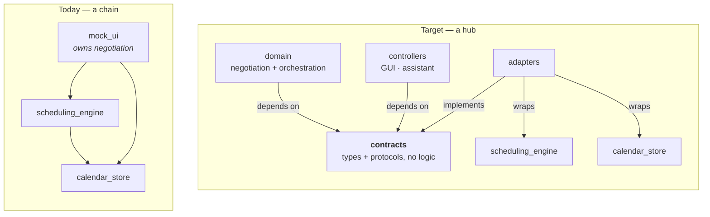
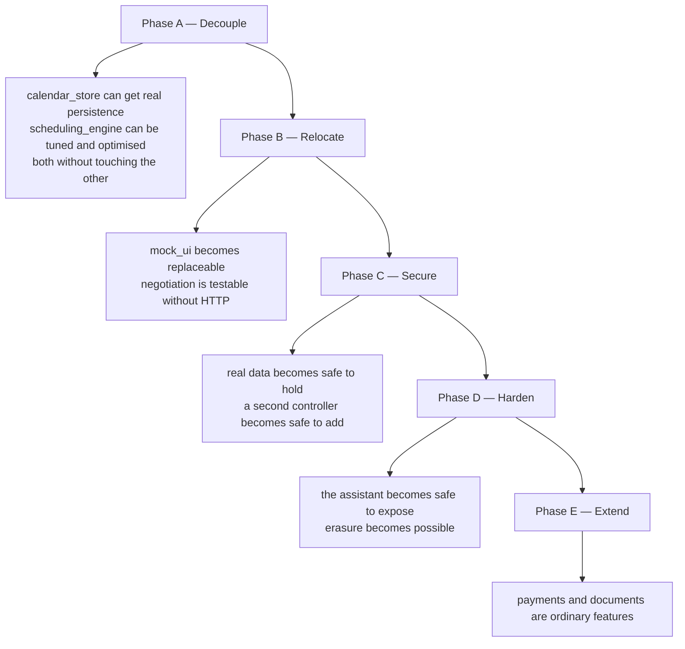

# Interface-first migration plan

Contracts first; implementations conform to them afterwards. Companion to
[CONTROL_SURFACE.md](CONTROL_SURFACE.md), which says *what* the commands are and
who may issue them — this says *how to get there* without a rewrite.

---

## 1. Why this order is the right one

Deriving an interface from the code you already have bakes in that code's
accidents. `World` grew inside a throwaway front end and is documented as such;
an interface extracted from it would inherit mock_ui's assumptions and then be
expensive to change once three packages depend on it.

Declaring the contract first inverts that: the contract states what the domain
*needs*, and each package's job becomes conforming to it. Once that holds, the
three engines stop being a chain and become independently replaceable — which is
exactly the property wanted here, because all three need work that has nothing to
do with each other:

| Package | Work it needs | Blocked today by |
|---|---|---|
| `calendar_store` | Real persistence (it is in-memory) | Everything imports it directly |
| `scheduling_engine` | Cost-model tuning, anchoring, performance | Imports `calendar_store`; called directly by `World` |
| `mock_ui` | Replacement by a real front end | Owns the negotiation lifecycle |

**The one risk, and the mitigation.** A contract designed with no implementation
feedback is usually wrong somewhere. But this is not a blind design: there are
471 tests and three detailed specs describing the behaviour the contract has to
admit. And each contract ships with a **conformance suite** — that is what turns
"abide by the interface" from an intention into something CI can fail on.

---

## 2. The dependency rule

**A port is declared by the consumer that needs it, not by the package that
happens to satisfy it.** The domain says "I need a window of availability"; an
adapter maps `calendar_store` onto that. The store never learns the domain
exists.

This is the whole mechanism. Get the arrows right and independent optimisation
follows; get them wrong and you have renamed the coupling.



In the target, `scheduling_engine` and `calendar_store` depend on **nothing** in
this system. They are libraries that adapters happen to call. That is what lets
you rewrite either one without opening the other.

---

## 3. The contracts

Five, in a package with no runtime dependencies of its own.

**`ControlSurface`** — the outward hook, the single thing a GUI or a chatbot
talks to.

```python
class ControlSurface(Protocol):
    def execute(self, session: Session, command: Command) -> Result: ...
    def draft(self, session: Session, command: Command) -> Draft: ...
    def confirm(self, session: Session, token: ConfirmationToken) -> Result: ...
```

`Command` is a closed union of the ~46 typed commands. Note what is absent: no
`client_id` argument. Identity arrives in `Session`.

**`AuthorizationPolicy`** — pure, and therefore exhaustively testable.

```python
class AuthorizationPolicy(Protocol):
    def decide(self, principal: Principal, command: Command,
               owner: Optional[ClientId]) -> Decision: ...
    # Decision = Allow | Deny(reason) | NeedsConfirmation
```

**`SchedulerPort`** — what the domain asks of an optimiser.

```python
class SchedulerPort(Protocol):
    def solve(self, problem: SchedulingProblem) -> SchedulingSolution: ...
    def bounds(self) -> BudgetBounds: ...   # what it will accept
```

One call, no CP-SAT in the signature. Swapping solvers, or changing the objective
entirely, becomes an adapter change.

**`CalendarRepository`** — what the domain asks of storage. Close to
`scheduling_engine/SPEC.md` §3, which already sketched it.

```python
class CalendarRepository(Protocol):
    def window(self, span: TimeRange, clients: Sequence[ClientId]) -> Snapshot: ...
    def book(self, ...) -> AppointmentId: ...
    def cancel(self, appointment_id: AppointmentId, *, by: Party) -> None: ...
    def reschedule(self, appointment_id: AppointmentId, to: TimeRange,
                   *, origin: Origin) -> AppointmentId: ...
```

`window` takes the client list, which is where **per-actor scoping** attaches: a
client's session can only ever produce a snapshot containing themselves.

**Side-effect ports** — `AuditSink` now; `NotificationPort`, `PaymentPort`,
`DocumentStore`, `KeyVault` as they arrive. Each is small and each keeps an
external system out of the domain.

---

## 4. Conformance suites

For every port, one test suite written against the *contract*, parameterised over
implementations:

```python
@pytest.fixture(params=["in_memory", "calendar_store_adapter", "postgres"])
def repo(request): ...
```

An implementation "abides by the interface" exactly when it passes. This is what
makes the independence real rather than declared: a rewritten store is correct
when the suite is green, without reading the domain's code.

It also gives every later step a safety net. Moving negotiation out of `mock_ui`
is a large change, but a change made against contracts that are already pinned.

---

## 5. The steps

### Phase A — Decouple *(no behaviour changes at all)*

> **A1 and A2 are done.** A1: the engine's 239 tests pass with no `calendar_store`
> installed (197 pass, 3 skip; the rest are the playground harness, now a dev
> extra). A2: `scheduling_contracts` installs with zero dependencies, declares 40
> commands and 4 ports, and 29 contract tests pass. Nothing imports it yet.

**A1. Cut the engine→store edge.** ✅
*Goal:* `scheduling_engine` stops depending on `calendar_store`.
*Write:* move `TimeSegment` into the contracts package (or let the engine own its
boundary type and convert in the adapter); move `playground.py`'s store usage to a
dev extra, since it is a harness rather than solver code.
*Done when:* the engine's 239 tests pass in a venv with no `calendar_store`
installed.
*Why first:* it is the smallest possible proof of the method, and the coupling is
almost entirely nominal — the solver core imports exactly one two-field dataclass.
Cheap, and it immediately unblocks the store's persistence work.

**A2. Declare the contracts package.** ✅
*Goal:* the five contracts exist as types and Protocols.
*Write:* command union, `Session`/`Principal`, `Decision`, the four ports.
*Done when:* it installs with zero runtime dependencies and nothing imports it yet.
*Why here:* everything downstream is written against it.
*Outcome:* 40 commands, a total permission matrix, and the attenuation property
proved across every (role, command) pair rather than by inspection. Two modelling
errors surfaced while writing the tests — command classes were not exported at
all, and an optional target (`request.list` with no client) had no defined
meaning; both are now pinned by tests.

**A3. Write the conformance suites.**
*Done when:* they run and fail honestly, with a documented list of what today's
packages do not yet satisfy.
*Why before the adapters:* a suite written after the adapter tends to describe the
adapter.

**A4. Build the adapters.**
*Goal:* `calendar_store` behind `CalendarRepository`; `solve_placements` behind
`SchedulerPort`.
*Done when:* conformance is green and `World` calls only through the ports.
*Why here:* end of Phase A, and the point at which both engines become
independently changeable. **Everything after this is optional to the decoupling
goal** — if you stopped here, you would already have what you asked for.

### Phase B — Relocate

**B1. Move negotiation out of `mock_ui` into a domain package.**
*Goal:* plans, approvals, holds, and `settle` live behind the contracts.
*Write:* the domain package; `mock_ui` keeps HTTP and rendering only.
*Done when:* the flow tests drive the domain directly and `mock_ui` imports
nothing from `calendar_store` or `scheduling_engine`.
*Why here:* it needs the ports to exist, and everything in Phase C attaches to it.

### Phase C — Secure

**C1. Typed commands with an explicit actor argument.**
Mechanical: each `World` method becomes a command. Actor is passed but not yet
enforced. No security value alone — it is the seam everything else clips onto.

**C2. Ambient identity.**
Sessions at the edge; the gate injects the actor; `client_id` is removed from
every payload. *Done when:* no request body anywhere carries an identity, and
`by_provider` is derived from the session rather than asserted by the caller.
**This is the load-bearing step** — no ownership rule can be enforced until the
system knows who is calling.

**C3. Capabilities, ownership, and scoped reads.**
The permission matrix from CONTROL_SURFACE §4; ownership predicates; `snapshot`
becomes a per-actor projection. *Done when:* a client session cannot obtain
another client's name by any route, proven by test.

**C4. Audit.**
Every command with actor, on-behalf-of, and outcome. *Why after C3:* auditing
unauthorised access is more useful once there is an authorisation decision to
record.

### Phase D — Harden

**D1. Optimiser bounds.** `optimiser.set_bounds` as a platform command; clamp both
the standing-default and per-run-override paths. Closes the unbounded
`horizon_days` hole.

**D2. Assistant delegation.** Delegated sessions, the allowlist intersection, and
draft/confirm with the token bound to a payload hash.

**D3. Crypto-shredding foundation.** `KeyVault` port, per-client keys, clinical
fields separated from scheduling fields so the two can be encrypted apart.
*Why before payments and documents:* both create clinical and financial records,
and retrofitting per-client encryption onto existing rows is far worse than
starting with it.

### Phase E — Extend

**E1. Payments. E2. Documents.** Both land on a gate that already authorises,
audits, and encrypts.

---

## 6. What each phase buys



Phase A is worth doing on its own merits and answers the question you actually
asked. C2 is the one step nothing else can precede — until identity is ambient,
every permission rule is decoration.
