# Showcase

What the app looks like today, on a phone. Everything here is generated by
[`capture.mjs`](capture.mjs) from the running app, so it can be rebuilt after
every change. The practice is made up: **Quiet Harbour Psychology** is a
fictional psychology practice in Singapore, with example clients and data.

## The walkthrough

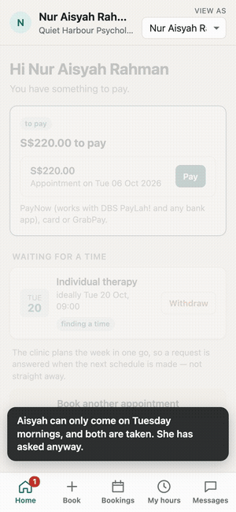

A one-minute story: a client who can only come on Tuesday mornings asks
anyway; the provider plans the week with one tap; the plan asks another
client to move; both clients agree on their own phones; the provider confirms,
and the diary updates. [Full-resolution video](walkthrough.mp4).

## For clients

| Home | Book | Bookings | My hours |
|---|---|---|---|
| 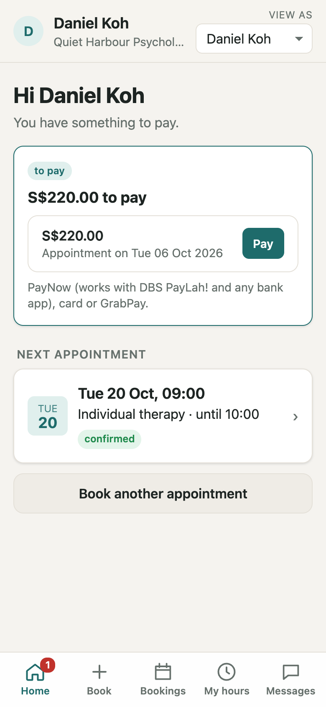 | 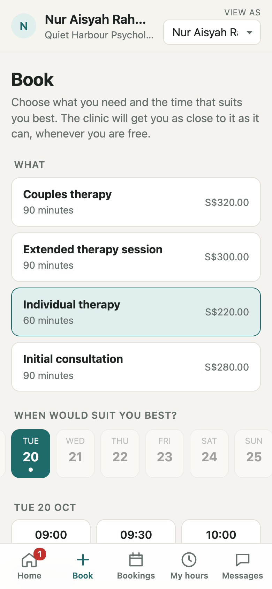 | 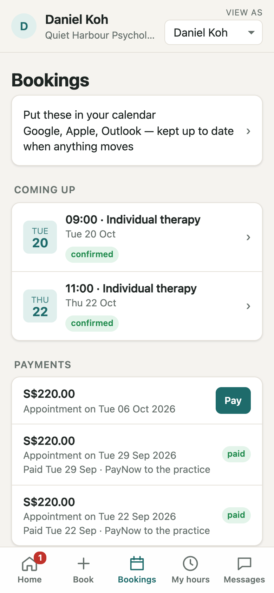 | 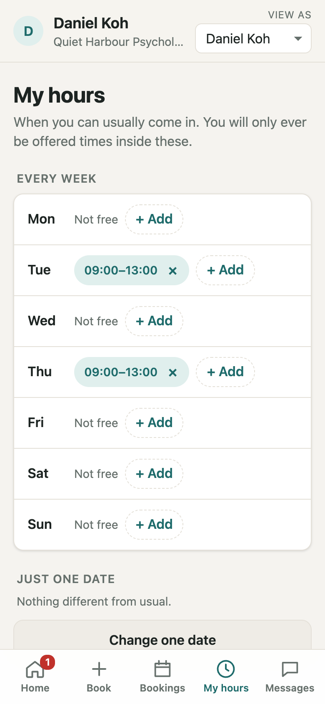 |
| What needs them, what to pay, the next appointment. | Choose a service and the time that suits best. A wish, not a booking. | Upcoming sessions, calendar sync, payments. | When they can usually come; they are only offered times inside it. |

| Messages | A time offered | Asked to move |
|---|---|---|
| 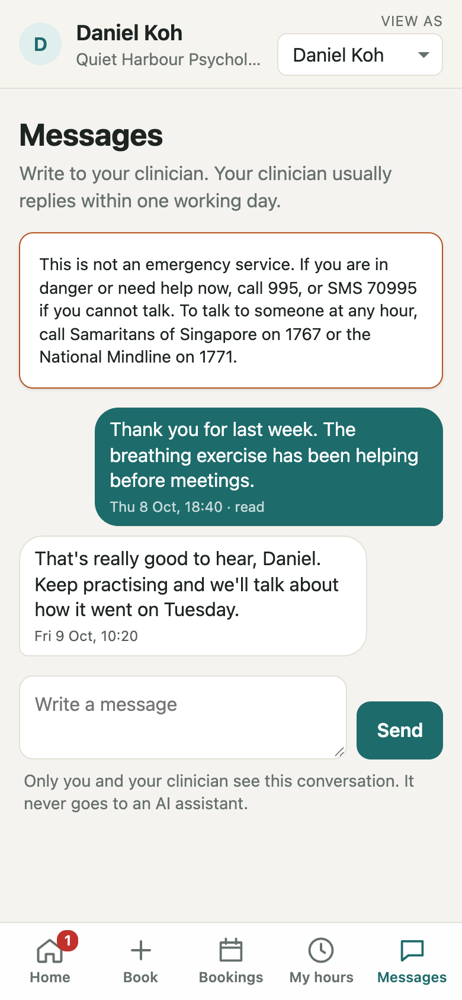 | 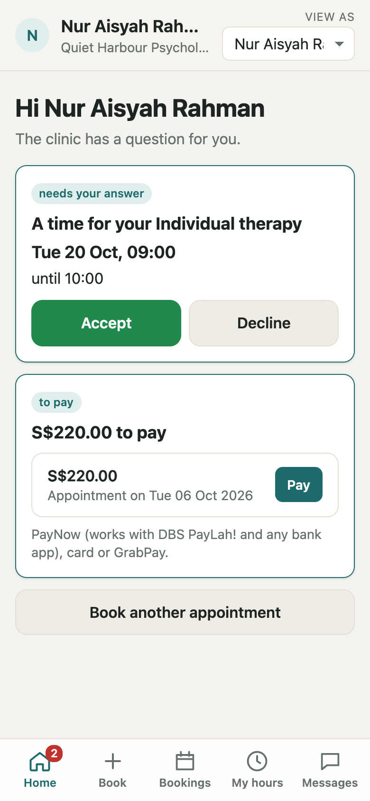 | 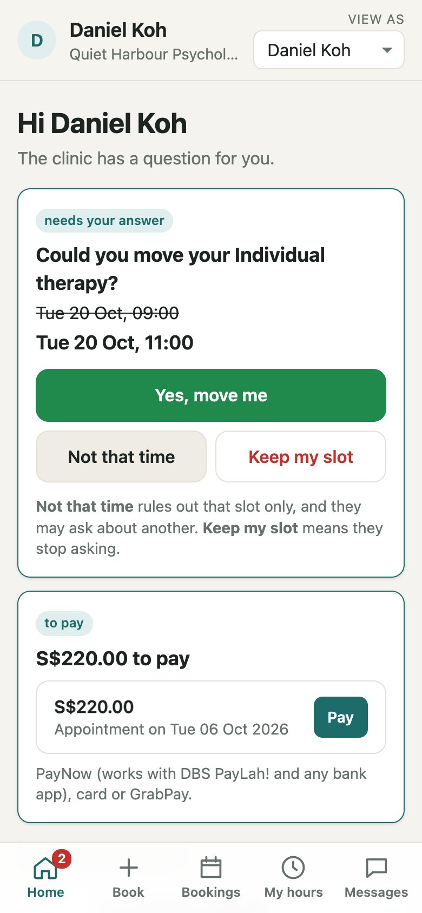 |
| A private conversation with the practice. Urgent-help numbers are always shown. | The clinic proposes a time; the client accepts or declines. | Exactly what changes, and three possible answers. Nothing moves without a yes. |

## For the provider

| Home | Diary | Requests | Plan |
|---|---|---|---|
| 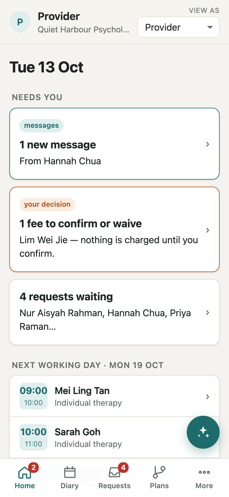 | 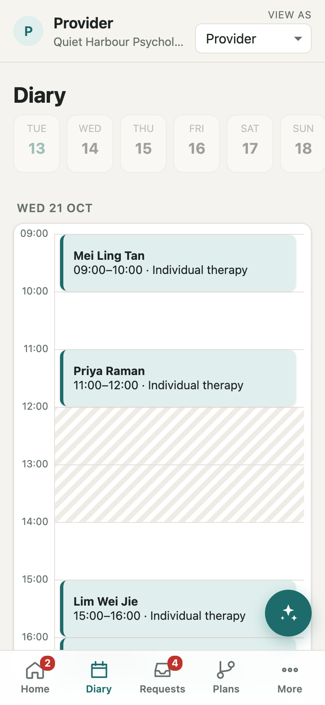 | 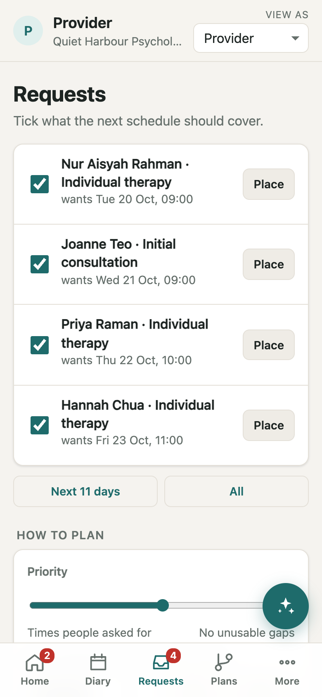 | 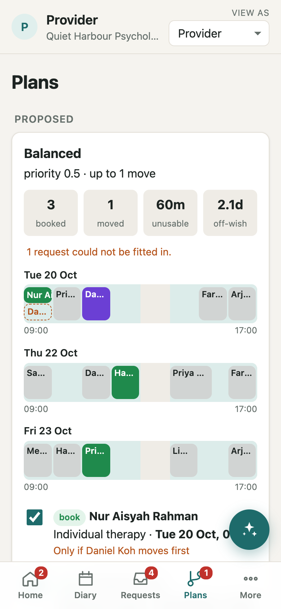 |
| Only what needs them today. | Open time plain, closed time hatched; moves stand out. | The waiting requests, ready to plan in one go. | The week planned at once: who is booked, who would move. |

| Waiting for answers | Clients | Payments | Time off |
|---|---|---|---|
| 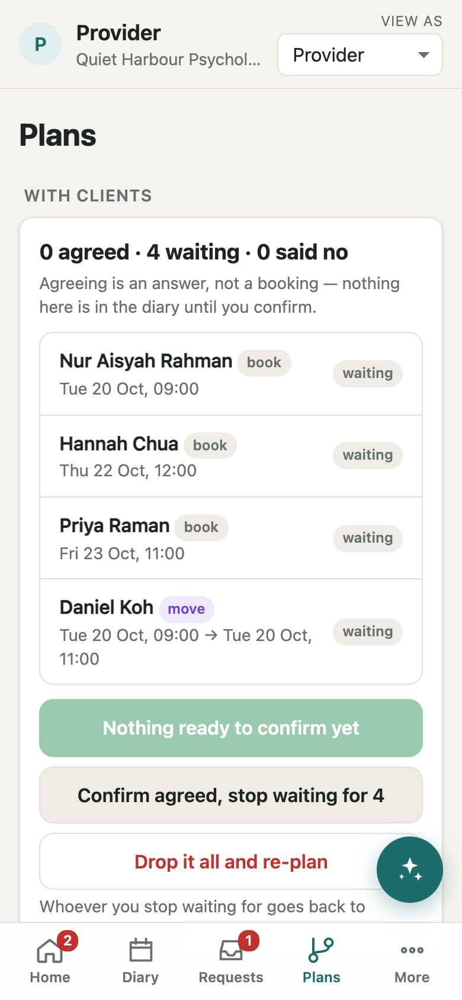 | 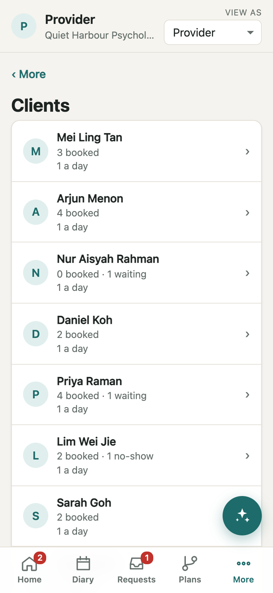 | 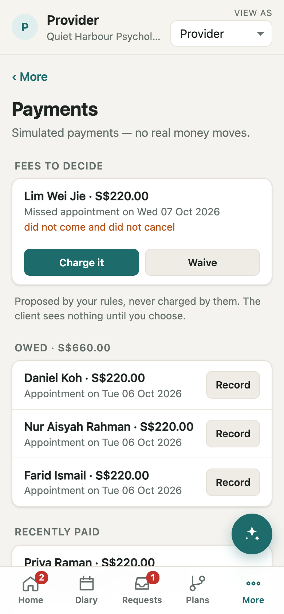 | 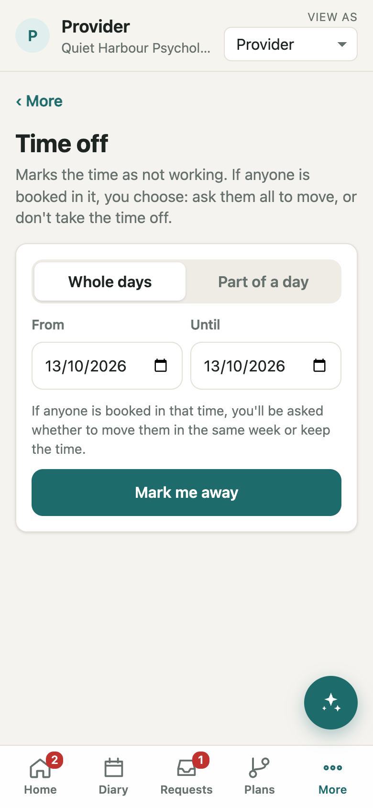 |
| Who agreed, who is still deciding; confirm what is agreed. | Each client's bookings and history. | Fees to decide, what is owed, what is paid. | Booked clients are asked to move; nothing is cancelled silently. |

| Messages | Working hours | More |
|---|---|---|
| 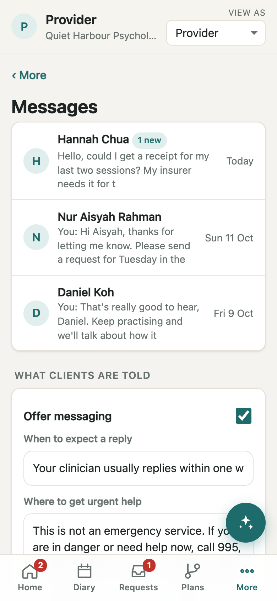 | 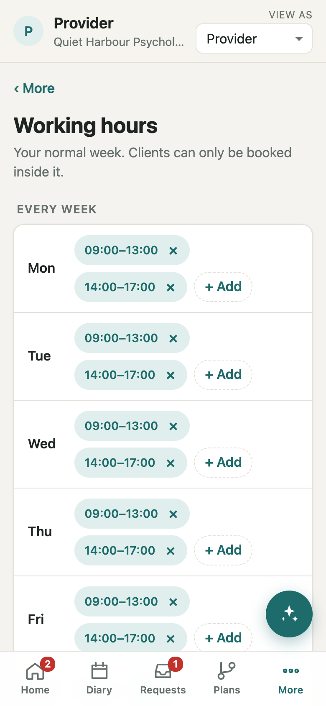 | 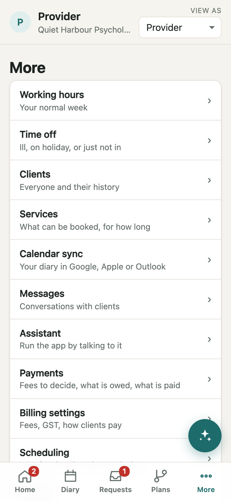 |
| Every client conversation, and what clients are told. | The normal week. | Settings, services, calendar sync, billing. |

## Dark mode

| Client home | Provider diary |
|---|---|
| 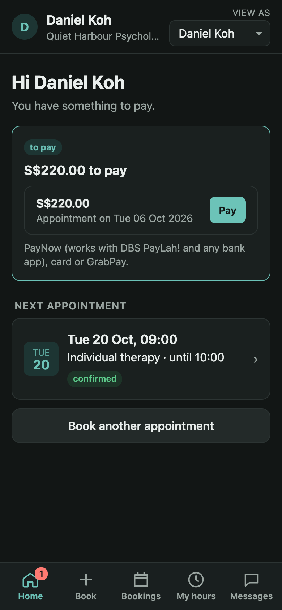 | 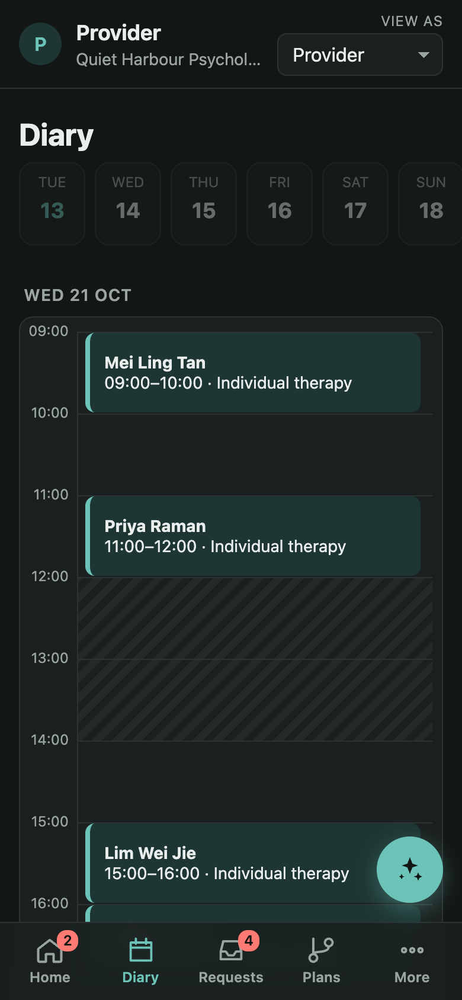 |

## Keeping it up to date

Rebuild after any change a user would see, and commit the result with it:

```bash
node showcase/capture.mjs
```

`--shots` skips the video when only screens changed. The script needs Google
Chrome and ffmpeg (set `CHROME=` if Chrome is elsewhere) and installs nothing.
It runs the app on its own port with a throwaway session, so a real session or
a running demo is never touched.

When a screen or button it uses has changed, the script stops and names the
step. Update the screen list or the walkthrough in `capture.mjs`, and the
captions in this file, to match. Dates in the screenshots follow the day they
were taken, because the example practice is set up relative to today.
